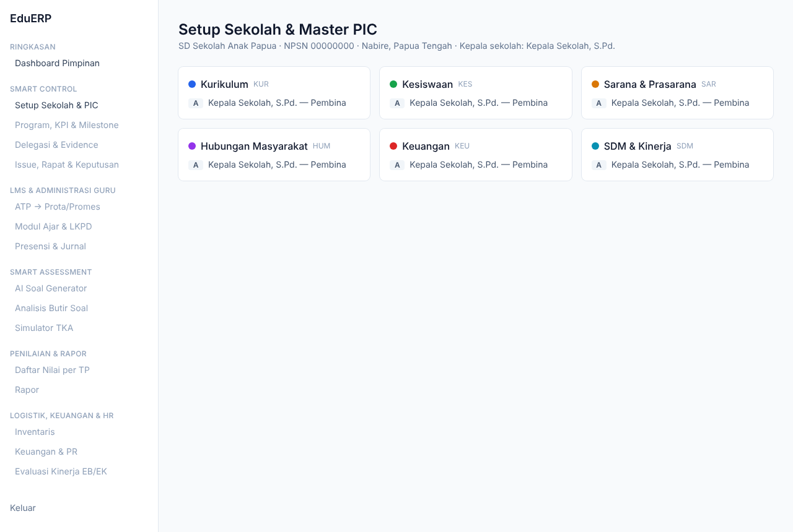

# EduERP — Sistem Manajemen Terpadu Sekolah

Migrasi **EduRapor (Google Apps Script, repo `yonesmontja/sap`)** ke arsitektur modern:

| Layer | Teknologi | Folder |
|---|---|---|
| Core ERP, Auth, Control Center, LMS, Rapor, Logistik, Keuangan, **API Gateway** | Laravel 13 (PHP 8.3) + Sanctum | [`apps/core-api`](apps/core-api) |
| UI/UX, LMS, Dashboard (BFF) | Next.js 16 + React 19 + Tailwind 4 | [`apps/web`](apps/web) |
| Smart Assessment: AI Soal Generator, Analisis Butir Soal | Django 5.2 + DRF + Celery + Claude API | [`apps/assessment`](apps/assessment) |
| Database | PostgreSQL 16 (+ Redis 7) | [`docker-compose.yml`](docker-compose.yml) |



## Dokumentasi

| # | Dokumen | Isi |
|---|---|---|
| 00 | [Strategi](docs/00-strategi.md) | RIM, F3, gap analysis, problem statement, WWW, opsi solusi, SWOT, roadmap, TDU, 4W1H |
| 01 | [Arsitektur](docs/01-arsitektur.md) | Diagram tingkat tinggi, keamanan antar-service (Sanctum, Service JWT, HMAC), bounded context |
| 02 | [ERD](docs/02-erd.md) | ERD per domain (mermaid) + pemetaan 30+ sheet lama → tabel |
| 03 | [API Gateway](docs/03-api-gateway.md) | Konvensi & daftar endpoint v1 (status ✅/⏳) |
| 04 | [Integrasi AI Soal](docs/04-integrasi-ai-soal.md) | Sequence Laravel ↔ Django ↔ Claude, kontrak API, keputusan desain |
| 05 | [Setup Lokal](docs/05-setup-lokal.md) | Instalasi langkah demi langkah 3 environment |
| 06 | [Spesifikasi dari EduRapor](docs/06-spesifikasi-edurapor.md) | Aturan bisnis sistem lama (STNKM, jurnal, P5, rapor, EWS, WA, import), peta halaman → modul, risiko & bug untuk migrasi |

## Struktur repositori

```
sapnabire/
├── .github/workflows/ci.yml     # tes ketiga service di setiap push
├── docker-compose.yml           # postgres, redis, mailpit
├── infra/postgres/init.sql      # database per service
├── docs/
├── apps/
│   ├── core-api/                # Laravel
│   │   ├── app/{Enums,Http,Models,Services}
│   │   ├── database/{migrations,seeders,factories}
│   │   ├── routes/api.php       # /api/v1/...
│   │   └── tests/Feature
│   ├── web/                     # Next.js (App Router, src/)
│   │   └── src/
│   │       ├── app/(auth)/login         # Server Action → Laravel, token di cookie httpOnly
│   │       ├── app/(dashboard)/...      # Server Components per modul
│   │       ├── lib/{api,session}.ts     # BFF fetch + sesi
│   │       ├── proxy.ts                 # guard rute (pengganti middleware di Next 16)
│   │       └── types/api.ts
│   └── assessment/              # Django
│       ├── config/              # settings, urls, celery
│       ├── core/                # Service JWT, callback HMAC
│       ├── generator/           # AI soal: planner, schemas, llm, tasks, models
│       ├── analysis/            # analisis butir, KKTP & remedial
│       └── tests/
```

Struktur modul berikutnya mengikuti pola yang sama, misalnya Laravel `app/Http/Controllers/Api/V1/Curriculum/*`, Next.js `src/app/(dashboard)/lms/*`, Django `exports/` dan `tryout/`.

## Mulai cepat

```bash
docker compose up -d
# lalu ikuti docs/05-setup-lokal.md untuk core-api (8000), assessment (8001), web (3000)
```

## Status Fase 1

- ✅ Migrasi + model + API: Setup Sekolah, Tahun Ajaran/Semester, Pegawai, Master Bidang (bertingkat), Master PIC (RACI, histori), audit log
- ✅ Auth Sanctum (username/email), RBAC per peran, isolasi tenant per sekolah
- ✅ Gateway Laravel → Django (Service JWT) + webhook balik (HMAC)
- ✅ Django: generator soal C1–C6 / LOTS–MOTS–HOTS (Claude, structured output, Celery), analisis butir soal + KKTP/remedial
- ✅ Next.js: login, layout modul, halaman Setup Sekolah & PIC
- ✅ Tes: Laravel 11 tes, Django 15 tes, Next.js lint + typecheck + build
