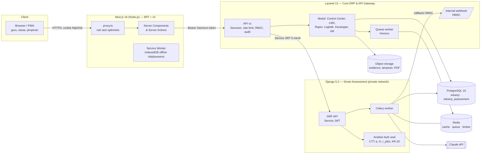

# 01 — Arsitektur Sistem

## 1. Prinsip desain

| Prinsip | Keputusan |
|---|---|
| **Satu pintu masuk** | Browser hanya bicara dengan Next.js. Next.js hanya bicara dengan Laravel. Django **tidak pernah** terekspos ke internet. |
| **Satu sumber kebenaran** | Master data (sekolah, pegawai, siswa, kelas, CP/TP/ATP, nilai) dimiliki Laravel. Django hanya menyimpan referensi ULID + data miliknya sendiri (job generator, bank soal AI, hasil analisis). |
| **Multi-tenant sejak hari pertama** | Semua tabel operasional punya `school_id`. Yayasan dengan banyak sekolah cukup satu instalasi. |
| **ID global** | ULID (26 karakter, terurut waktu) untuk entitas domain → aman untuk sinkronisasi offline (nilai/presensi) dan referensi lintas service. |
| **Kerja berat = asinkron** | Generate ratusan soal, ekspor PDF/Word, rekap rapor → antrean (Redis + Celery di Django, Redis + Horizon di Laravel). API langsung membalas `202 Accepted` + ID job. |
| **Histori tidak dihapus** | Penugasan PIC diakhiri (`ended_on`), pegawai di-soft-delete, audit trail append-only. Laporan tahun lalu tetap akurat. |

## 2. Diagram tingkat tinggi

## 3. Keamanan komunikasi antar-komponen

| Jalur | Mekanisme | Detail |
|---|---|---|
| Browser → Next.js | Cookie `eduerp_session` **httpOnly, Secure, SameSite=Lax** | Token tidak bisa dibaca JavaScript (tahan XSS). `proxy.ts` hanya mengecek keberadaan cookie; validasi sesungguhnya di Laravel. |
| Next.js → Laravel | **Laravel Sanctum** personal access token (opaque, disimpan hash SHA-256 di DB) | Kedaluwarsa 12 jam, ability = peran user, dapat dicabut per perangkat. Login di-throttle 5×/menit. |
| Laravel → Django | **Service JWT HS256**, umur ≤ 5 menit | Klaim: `iss=eduerp-core`, `aud=eduerp-assessment`, `sub`, `school_id`, `role`, `scopes[]`. Django menolak token tanpa `school_id`/`exp`. Scope per peran (mis. siswa tidak punya `assessment:generate`). |
| Django → Laravel | **Webhook HMAC-SHA256** atas `"<timestamp>.<body>"` | Toleransi 5 menit (anti-replay), `hash_equals` (anti timing attack). |
| Django → Claude API | API key di environment Django saja | Laravel & Next.js tidak pernah memegang key AI. Menggantikan `api_key_gemini` yang dulu tersimpan di sheet `PengaturanSekolah`. |

**Kenapa Sanctum + JWT, bukan OAuth2 penuh (Passport)?** Seluruh klien adalah aplikasi pihak pertama. OAuth2 authorization-code baru bernilai saat ada aplikasi pihak ketiga (mis. integrasi Dapodik/e-Rapor Kemendikbud, aplikasi orang tua buatan vendor lain). Jalur upgrade: tambahkan Laravel Passport di gateway yang sama tanpa mengubah Django — Django tetap menerima Service JWT.

**Produksi:** ganti HS256 menjadi **RS256** (Laravel memegang private key, Django hanya public key), sehingga kebocoran di Django tidak bisa dipakai memalsukan token.

## 4. Pembagian tanggung jawab (bounded context)

| Service | Memiliki | Tidak memiliki |
|---|---|---|
| **Laravel** `apps/core-api` | Auth & RBAC, tenant, Control Center (15 sheet → relasional), CP/TP/ATP, Prota/Promes, KKTP, Modul Ajar, presensi, jurnal, nilai per TP, rapor, inventaris, keuangan & PR, EB/EK, audit, file storage, notifikasi | Pemanggilan LLM, statistik butir soal |
| **Django** `apps/assessment` | Job generator soal, bank soal (draft → reviewed → published), analisis butir (p, D, r_pbis, pengecoh, KR-20), ketuntasan KKTP, paket Tryout/TKA, render kisi-kisi & kartu soal (DOCX/PDF/XLSX) | Data siswa/guru (hanya ID), login user |
| **Next.js** `apps/web` | UI, BFF, editor soal (KaTeX), dashboard interaktif, PWA offline untuk input nilai & presensi | Logika bisnis, akses DB langsung |

## 5. Pola penting

Sudah diterapkan di Fase 1: Idempotency-Key (generator). Lainnya adalah standar yang diterapkan saat modul terkait dibangun (lihat roadmap di `00-strategi.md`).

- **Idempotency-Key** pada semua endpoint yang membuat job (generator, ekspor) → klik ganda / retry jaringan tidak membuat job kembar.
- **Outbox offline** (fase LMS): Next.js menyimpan nilai/presensi di IndexedDB dengan ULID buatan klien, lalu `POST /sync` batch; Laravel `upsert` berdasar ULID sehingga sinkronisasi ulang aman.
- **Read model dashboard**: Dashboard Pimpinan membaca *materialized view* PostgreSQL (`mv_program_progress`, `mv_kpi_achievement`) yang di-refresh oleh job terjadwal setiap 15 menit — query berat tidak membebani transaksi harian.
- **Observability**: setiap request membawa `X-Request-Id` dari Next.js → Laravel → Django agar satu alur bisa ditelusuri di log ketiga service.
