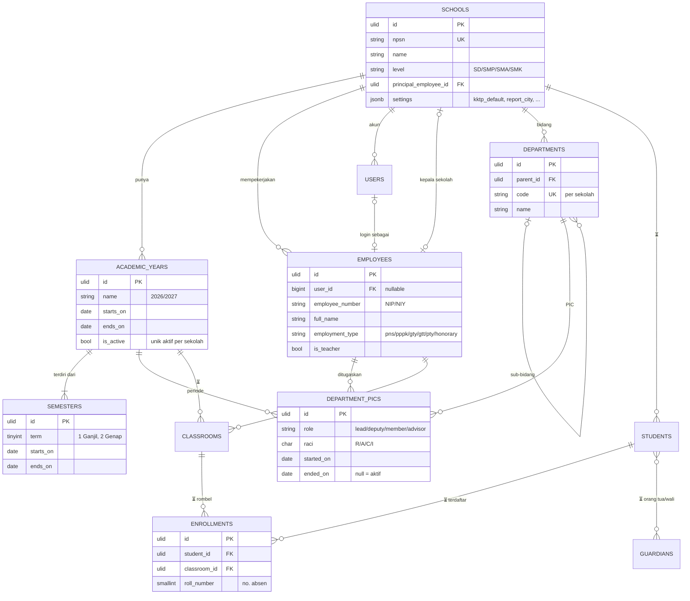
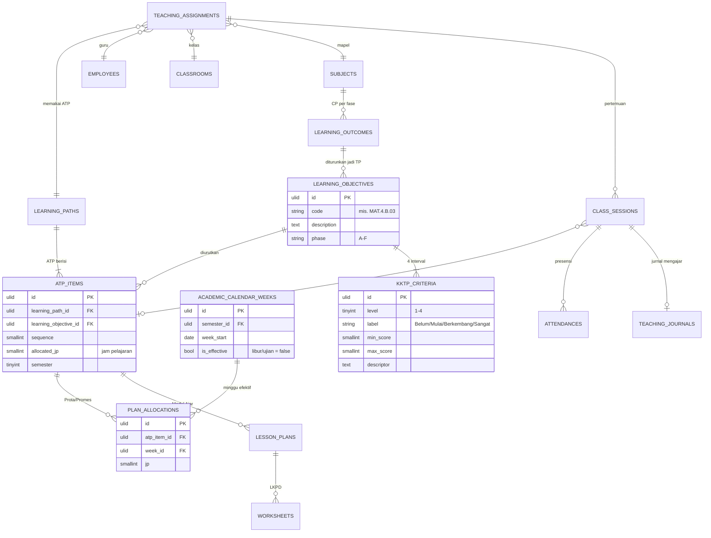
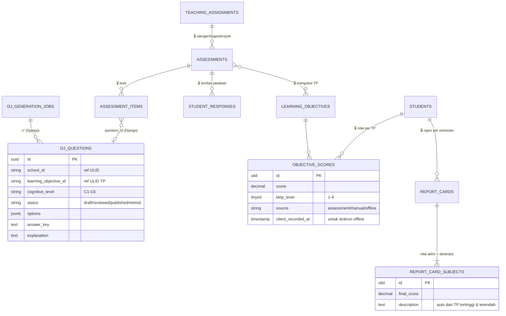
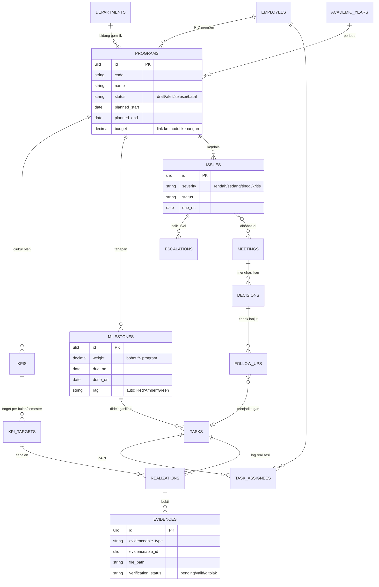
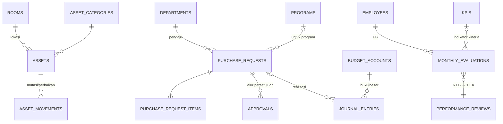
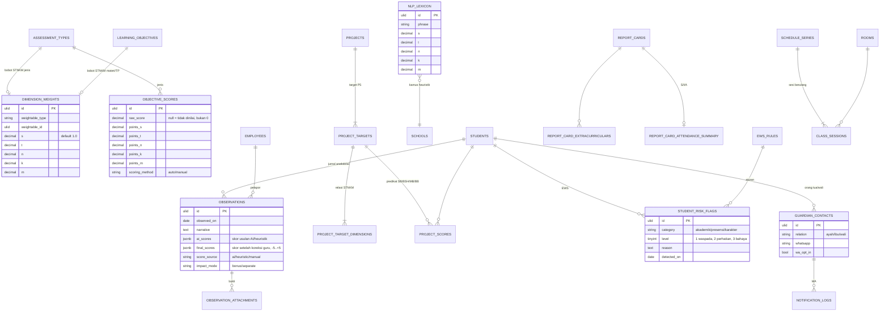

# 02 — ERD Konseptual

ERD dipecah per domain agar terbaca. Semua tabel (kecuali yang ditandai) memiliki `school_id` → `schools.id` untuk isolasi tenant; demi ringkas, relasi `school_id` tidak digambar ulang di setiap diagram.

Legenda status: ✅ sudah ada migrasinya di Fase 1 · ⏳ fase berikutnya.

## A. Inti: Sekolah, Orang, Kelas (✅ sebagian)

## B. Kurikulum & LMS: CP → TP → ATP → Prota/Promes → Modul Ajar (⏳)

Tulang punggungnya adalah **TP (learning_objectives)**: semua artefak guru (Prota, Promes, Silabus, KKTP, Modul Ajar, jurnal, nilai, soal) menunjuk ke TP, sehingga perubahan ATP otomatis mengalir ke dokumen turunannya.

**Prota/Promes otomatis**: generator membagi `atp_items.allocated_jp` secara berurutan ke `academic_calendar_weeks` yang `is_effective = true` sesuai JP mingguan mapel (dari jadwal). Hasilnya disimpan di `plan_allocations` — Prota = agregasi per semester, Promes = matriks TP × minggu.

## C. Penilaian, Rapor & Smart Assessment

`DJ_*` = tabel milik Django di database `eduerp_assessment`. Relasi lintas database hanya berupa ID (tanpa foreign key fisik).

## D. SMART Control Center (15 sheet → relasional)

| Sheet lama | Tabel |
|---|---|
| Home, Navigasi | — (menjadi UI/menu) |
| Setup Sekolah | `schools`, `academic_years`, `semesters` ✅ |
| Master Bidang & PIC | `departments`, `department_pics` ✅ |
| Master Program | `programs` |
| KPI & Target | `kpis`, `kpi_targets` (per periode) |
| Milestone, Timeline | `milestones` (tanggal rencana/aktual, bobot) |
| Delegasi Tugas | `tasks` (RACI per tugas → `task_assignees`) |
| Log Realisasi | `realizations` |
| Evidence Register | `evidences` (file di object storage, polymorphic ke task/milestone/kpi) |
| Issues, Eskalasi | `issues`, `escalations` |
| Rapat, Keputusan, Tindak Lanjut | `meetings`, `meeting_attendees`, `decisions`, `follow_ups` |
| Review & Laporan | materialized view + generator dokumen |

**Indikator Dashboard Pimpinan** dihitung dari relasi di atas:
- *% Selesai program* = Σ bobot milestone selesai.
- *Keterlambatan* = milestone `done_on IS NULL AND due_on < today`.
- *Evidence belum lengkap* = realisasi tanpa evidence `valid`.
- *Issue kritis* = `severity = kritis AND status ≠ closed`.
- *Rata-rata capaian KPI* = rata-rata (realisasi ÷ target) per KPI aktif.

## E. Logistik, Keuangan & HR (⏳)

## F. Pemetaan dari sistem lama (Google Sheets → PostgreSQL)

| Sheet lama (`sap/Code.gs`) | Tabel baru | Catatan migrasi |
|---|---|---|
| `Users` | `users` | Password lama **plaintext** → wajib reset; akun dibuat ulang dengan hash bcrypt. |
| `PengaturanSekolah` | `schools` (+`settings`) | `api_key_gemini` **tidak dimigrasi**; pindah ke secret Django. |
| `MasterGuru` | `employees` (+`users`) | `nip_nik` → `employee_number`. |
| `MasterPeriode` | `academic_years` + `semesters` | |
| `TransLogAktivitas` | `activity_logs` | |
| `MasterSiswa`, `MasterOrtu`, `MasterWali`, `MasterWilayah`, ... | `students`, `guardians`, referensi wilayah Kemendagri | |
| `MasterKelas`, `MasterMapel` | `classrooms`, `subjects`, `teaching_assignments` | |
| `MasterMateri` (+ matriks STNKM), `MasterMBK` (+ matriks STNKM) | `learning_objectives`, `assessment_types` + `dimension_weights` | Matriks S-T-N-K-M dipertahankan sebagai bobot dimensi (lihat bagian G). |
| `TransNilai`, `RekapRaporAkhir` | `objective_scores` (+ `points_s..m`, `scoring_method`), `report_cards` | Periksa `id_nilai` ganda akibat bug pembaruan baris (06 §5.3). |
| `TransPresensi` | `attendances` | Normalisasi kode H/S/I/A. |
| `TransJurnal` (jurnal anekdotal) | `observations`, `observation_attachments` | Lampiran dipindah dari Drive publik ke penyimpanan privat. |
| `TransJadwal` | `schedule_series`, `class_sessions` | `id_group` → seri jadwal. |
| `MasterBankPengetahuan` | `knowledge_assets` | |
| `HEURISTIK_DICT` (hardcoded di `jurnal.html`) | `nlp_lexicon` | Dikelola admin dari UI. |
| `PengaturanSekolah` (WA: `status_wa_api`, `wa_api_token`, `no_wa_kepsek`, `id_wa_group_guru`) | `schools.settings` + secret terenkripsi | Token tidak disimpan polos. |
| `MasterProyek`, `MasterTargetP5`, `TransNilaiP5`, `TransCatatanP5` | `projects`, `project_targets`, `project_scores` | |
| `TransCatatanWali` | `report_cards.homeroom_note` | |

## G. Tambahan dari sistem lama: STNKM, Jurnal, P5, Rapor, Notifikasi (⏳)

Rinciannya ada di [`06-spesifikasi-edurapor.md`](06-spesifikasi-edurapor.md).

