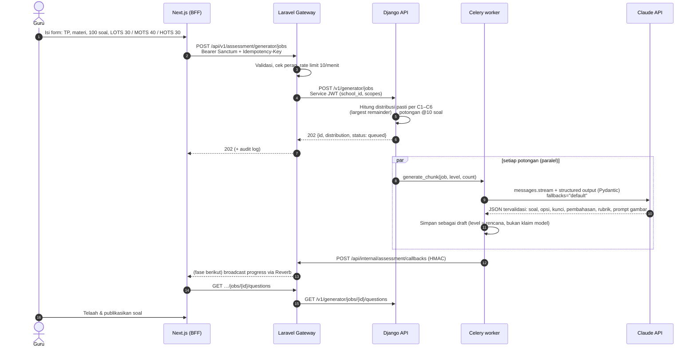

# 04 — Integrasi Laravel ↔ Django: AI Soal Generator

## 1. Alur end-to-end



## 2. Kontrak API Django (internal)

`POST /v1/generator/jobs` — scope `assessment:generate`

```json
{
  "idempotency_key": "atp-01K…-run-1",
  "learning_objective_id": "01K…",
  "subject": "IPA",
  "grade": "Kelas 5 (Fase C)",
  "learning_objective": "Peserta didik dapat menjelaskan siklus air dan dampaknya bagi kehidupan.",
  "material": "…teks materi dari guru / Modul Ajar…",
  "question_type": "multiple_choice",
  "options_count": 4,
  "total": 100,
  "tier_distribution": {"LOTS": 30, "MOTS": 40, "HOTS": 30}
}
```
Alternatif: `"level_distribution": {"C1": 10, "C2": 20, "C3": 30, "C4": 20, "C5": 15, "C6": 5}` (persentase atau bobot; tepat satu dari keduanya).

Respons `202`:
```json
{"id": "6f1c…", "status": "queued", "total_requested": 100,
 "distribution": {"C1": 15, "C2": 15, "C3": 40, "C4": 10, "C5": 10, "C6": 10}, "progress": 0}
```

Status job: `queued → running → completed | partial | failed`. `partial` = sebagian potongan gagal (ditolak model / error), soal yang berhasil tetap tersimpan dan bisa dilengkapi dengan job susulan.

`POST /v1/analysis/item-analysis` — stateless:
```json
{"keys": {"Q1": "A", "Q2": "C"},
 "answers": {"siswa-01": {"Q1": "A", "Q2": "B"}, "siswa-02": {"Q1": "D", "Q2": "C"}},
 "kktp_threshold": 75}
```
→ per butir: `difficulty` (p), `discrimination` (D, kelompok atas/bawah 27%), `point_biserial` (terkoreksi), sebaran opsi, pengecoh tidak berfungsi, keputusan `terima/revisi/buang` + rekomendasi revisi; level tes: rerata, SD, **KR-20**, SEM; serta `mastery`: sebaran 4 interval KKTP, daftar **remedial** dan **pengayaan**.

## 3. Keputusan desain

| Topik | Keputusan | Alasan |
|---|---|---|
| Model | `claude-opus-5-5`, effort `high` (diatur via `AI_MODEL`) | Kualitas soal HOTS & pengecoh berbasis miskonsepsi butuh penalaran kuat. Bisa diturunkan per sekolah setelah ada evaluasi kualitas. |
| Format output | Structured outputs (`output_format=GeneratedBatch` Pydantic) | Tidak ada parsing teks rapuh; skema yang sama memvalidasi ulang di sisi kita. |
| Streaming | `client.beta.messages.stream(...).get_final_message()` | Output 10 soal + pembahasan bisa panjang; streaming menghindari timeout HTTP. |
| Penolakan model | `fallbacks="default"` (beta `server-side-fallback-2026-07-01`) + cek `stop_reason == "refusal"` | Materi sensitif (mis. biologi reproduksi, sejarah konflik) bisa memicu penolakan; API otomatis mencoba model pengganti. Bila tetap ditolak → potongan ditandai gagal, job `partial`. |
| Skala ratusan soal | Dipecah per level × 10 soal, dikerjakan paralel oleh Celery | Kegagalan satu potongan tidak menggagalkan job; retry eksponensial untuk 429/5xx. |
| Komposisi kesulitan | Metode sisa terbesar (Hamilton) | Jumlah per level selalu tepat total yang diminta (tidak 99 atau 101). |
| Duplikasi soal | 30 pokok soal terakhir di level yang sama dikirim sebagai daftar "hindari" | Murah dan efektif; fase berikut: deteksi kemiripan dengan embedding/pg_trgm. |
| Level kognitif | Disimpan dari **rencana**, bukan dari klaim model | Distribusi C1–C6 yang diminta guru terjamin di kisi-kisi. |
| Kualitas | Soal AI selalu `draft`; wajib ditelaah guru sebelum `published` | AI asisten penulis soal, guru tetap penanggung jawab. Analisis butir setelah ujian menutup siklus (soal `buang` → `retired`). |
| Rumus & gambar | LaTeX `$…$` (dirender KaTeX di web, dikonversi ke OMML saat ekspor Word); `image_prompt` untuk soal sains | Siap cetak tanpa merangkai tabel Word manual. |
| Biaya | Ukur `usage` per job di log; opsi berikutnya: Message Batches API (diskon 50%, asinkron) untuk job besar non-mendesak | Batches tidak mendukung `fallbacks`, jadi dipakai hanya untuk materi non-sensitif. |

## 4. Fase berikutnya untuk modul ini

1. Endpoint telaah (`PATCH /v1/questions/{id}`) + editor soal di Next.js (KaTeX live preview).
2. Ekspor: kisi-kisi (tabel TP × level × nomor soal), kartu soal, naskah + lembar jawaban → `python-docx`, `WeasyPrint` (PDF), `openpyxl` (XLSX). Simpan ke object storage, kirim URL via callback.
3. Simulator TKA: blueprint (mapel × domain × level) → ambil dari bank soal `published` + generate kekurangan.
4. Eval kualitas generator: 50 TP contoh × rubrik telaah (kesesuaian TP, satu kunci, pengecoh homogen, bahasa) sebelum mengganti model/prompt.
