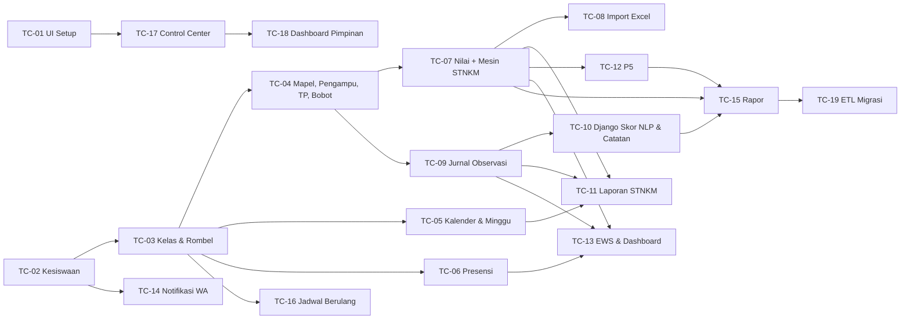

# 07 — Spesifikasi Teknis untuk Agen AI (Agentic Build Spec)

> **Untuk siapa:** agen coding (Claude Code, Codex, Cursor, Devin, dan sejenisnya) serta manusia yang memberi tugas kepada agen.
> **Cara pakai singkat:** salin **Prompt Induk (§1)**, lalu tempelkan **satu Kartu Tugas (§6)**. Satu prompt = satu kartu = satu PR.
> **Sumber kebenaran:** bila ada pertentangan, urutan prioritasnya: Invarian `INV-*` (§3) → Kartu Tugas → `02-erd.md`/`03-api-gateway.md` → kode yang ada.

---

## 0. Ringkasan sistem (konteks wajib)

EduERP adalah pengganti **EduRapor** (Google Apps Script + Google Sheets) untuk sekolah, mulai dari SD Sekolah Anak Papua (Nabire, Papua Tengah, zona waktu `Asia/Jayapura`). Sistemnya multi-sekolah (yayasan).

| Service | Tanggung jawab | Status |
|---|---|---|
| `apps/core-api` (Laravel 13) | Auth Sanctum, tenant, master data, akademik, rapor, Control Center, ERP, API Gateway `/api/v1`, webhook internal | Fase 1 ✅ (Setup Sekolah, Tahun Ajaran, Pegawai, Bidang, PIC, audit, gateway AI) |
| `apps/assessment` (Django 5.2) | Generator soal AI (Celery + Claude), analisis butir (CTT), ketuntasan KKTP; berikutnya: skor NLP jurnal, draf catatan rapor | Generator & analisis ✅ |
| `apps/web` (Next.js 16) | UI + BFF; token di cookie httpOnly | Login, layout, halaman Setup ✅ |

Dokumen pendukung: `00-strategi.md` (roadmap), `01-arsitektur.md` (keamanan antar-service), `02-erd.md` (ERD A–G), `03-api-gateway.md` (endpoint), `04-integrasi-ai-soal.md`, `05-setup-lokal.md`, `06-spesifikasi-edurapor.md` (aturan bisnis sistem lama, **wajib dibaca untuk tugas akademik**).

---

## 1. Prompt Induk (salin apa adanya)

```text
Anda adalah engineer senior yang bekerja di monorepo EduERP (Laravel 13 + Django 5.2 + Next.js 16 + PostgreSQL 16).

Sebelum menulis kode:
1. Baca AGENTS.md, docs/07-spesifikasi-teknis-agen.md (§2 konvensi, §3 invarian), dan dokumen yang dirujuk kartu tugas.
2. Pelajari pola yang sudah ada dan tirulah: modul Setup Sekolah & PIC di apps/core-api
   (migrations 2026_10_18_1000xx, Models/Department*.php, Requests/V1, Resources/V1,
   Controllers/Api/V1/DepartmentPicController.php, tests/Feature/Control/SchoolSetupTest.php).
3. Jalankan tes yang ada untuk memastikan baseline hijau.

Saat bekerja:
- Kerjakan HANYA kartu tugas di bawah. Jangan menambah fitur, merapikan kode di luar cakupan, atau mengubah invarian INV-*.
- Setiap kriteria penerimaan (AC) harus punya minimal satu tes otomatis yang namanya merujuk ID AC.
- Jika spesifikasi ambigu atau bertentangan, berhenti di titik itu, tulis pertanyaan di bagian "Keputusan terbuka"
  pada laporan, dan pilih opsi paling konservatif yang tidak mengubah data/skema bila memang harus melanjutkan.
- Jangan pernah memakai data siswa asli; gunakan factory/faker.
- Jangan menyimpan/menampilkan rahasia (API key, token, password).

Sebelum selesai:
- Jalankan semua perintah verifikasi di AGENTS.md untuk service yang Anda sentuh; semuanya harus hijau.
- Perbarui docs/03-api-gateway.md (status ✅) dan docs/02-erd.md bila endpoint/skema berubah.
- Laporkan dengan format docs/07 §8.

KARTU TUGAS:
<tempel satu kartu dari §6 di sini>
```

---

## 2. Konvensi teknis

### 2.1 Laravel (`apps/core-api`)
| Aspek | Aturan |
|---|---|
| Primary key | `$table->ulid('id')->primary()` + trait `HasUlids`. FK domain: `foreignUlid(...)->constrained()`. FK ke users: `foreignId('user_id')`. |
| Tenant | Kolom `school_id` + trait `App\Models\Concerns\BelongsToSchool`. Controller: `Model::forSchool($request->user()->school_id)`; route model binding → `$this->ensureSameSchool($request, $model->school_id)` (404). |
| FK ke diri sendiri | Buat kolom dulu, tambahkan `foreign()` di `Schema::table` setelah `create` (PK harus sudah ada). |
| Constraint | Unik parsial & `CHECK` via `DB::statement` di migrasi (contoh: `department_pics_one_lead`). |
| Enum | PHP backed enum di `app/Enums`, kolom `string` + cast; batasan nilai di `CHECK` atau `Rule::enum`. |
| Default atribut | Kolom dengan default DB yang dibaca di request yang sama → isi juga `$attributes` di model (lihat `User`, `Employee`). |
| Validasi | FormRequest per aksi di `app/Http/Requests/V1`. `exists`/`unique` selalu `->where('school_id', ...)`. |
| Respons | JsonResource di `app/Http/Resources/V1`. Tanggal `Y-m-d`, enum `->value`. Tidak pernah mengirim kolom rahasia. |
| Otorisasi | Middleware `role:<peran,...>` (super_admin selalu lolos) + Policy untuk aturan kepemilikan (mis. guru hanya kelas yang diampu). |
| Audit | `ActivityLog::record($request, '<modul>', '<event>', $subject, [...])` di setiap aksi tulis. |
| Kerja berat | Job antrean (`ShouldQueue`), endpoint mengembalikan `202` + ID; header `Idempotency-Key` untuk pembuat job. |
| Batch tulis | Satu transaksi (`DB::transaction`), `upsert` berbasis kunci alami bila memungkinkan. |
| Tes | `tests/Feature/<Modul>/*Test.php`, `RefreshDatabase`, PostgreSQL (`eduerp_test`). Wajib ada tes isolasi tenant dan tes peran terlarang untuk setiap endpoint baru. |
| Gaya | `./vendor/bin/pint`. |

### 2.2 Django (`apps/assessment`)
| Aspek | Aturan |
|---|---|
| Auth | Hanya `ServiceJWTAuthentication` (JWT HS256 dari Laravel, klaim `school_id`, `scopes`). Tambahkan scope baru di `AssessmentClient::ROLE_SCOPES` (Laravel) dan `required_scope` view. |
| Tenant | Setiap model punya `school_id` (CharField 26); queryset selalu difilter `request.user.school_id`. |
| LLM | Anthropic SDK, model dari `settings.AI["MODEL"]` (default `claude-opus-5-5`), structured output Pydantic, streaming + `get_final_message()`, `fallbacks="default"` (beta `server-side-fallback-2026-07-01`), cek `stop_reason == "refusal"`. Pola lengkap ada di `generator/llm.py`. |
| Tes | LLM selalu di-mock di tes (`mock.patch`). Logika murni (statistik, pembobotan) di modul tanpa I/O dengan unit test. |

### 2.3 Next.js (`apps/web`)
| Aspek | Aturan |
|---|---|
| Versi | Next 16: `proxy.ts` (bukan middleware), `cookies()` async, Cache Components aktif → halaman data di bawah `loading.tsx`/`<Suspense>`. Baca `node_modules/next/dist/docs` bila ragu. |
| Data | Server Component + `api()` dari `src/lib/api.ts`. Mutasi lewat Server Action. Tipe respons di `src/types/api.ts`. |
| Offline (PWA) | Hanya untuk presensi & nilai: IndexedDB + ULID klien + `POST /sync/offline`. |
| UI | Tailwind; label Bahasa Indonesia; tabel besar memakai paginasi server. |

### 2.4 Penamaan istilah domain
| Istilah sekolah | Nama kode |
|---|---|
| Tahun ajaran / semester | `academic_years` / `semesters` |
| Rombel / kelas | `classrooms` |
| Mapel | `subjects` |
| Guru mengampu mapel di kelas | `teaching_assignments` |
| CP / TP / ATP | `learning_outcomes` / `learning_objectives` / `learning_paths` + `atp_items` |
| Materi (sistem lama) | `learning_objectives` (atau `topics` bila tidak terkait TP; lihat DEC-03) |
| Jenis penilaian (MBK) | `assessment_types` |
| Nilai | `objective_scores` |
| Jurnal anekdotal | `observations` |
| Jurnal mengajar | `teaching_journals` |
| Presensi | `attendances` |
| Wali kelas | `classrooms.homeroom_employee_id` |
| Orang tua/wali | `guardians` + `guardian_contacts` |

---

## 3. Invarian bisnis (kontrak, wajib diuji)

> Setiap invarian punya ID. Tes yang membuktikan invarian diberi nama yang memuat ID, mis. `test_inv07_points_use_both_weight_layers`.

**Platform**
- **INV-01 Tenant.** Tidak ada endpoint yang membaca/menulis data sekolah lain. ID lintas tenant → 404, referensi lintas tenant di body → 422.
- **INV-02 Histori.** Tidak ada hard delete untuk data akademik/penugasan. Penghapusan = soft delete atau `ended_on`.
- **INV-03 Audit.** Setiap aksi tulis menghasilkan satu baris `activity_logs` yang dicatat di server.
- **INV-04 Rahasia.** Token gateway WA, API key, dan password tidak pernah muncul di respons API, log, atau repo. Kolom rahasia memakai cast `encrypted`.
- **INV-05 Draf AI.** Keluaran AI (soal, skor jurnal, catatan rapor, catatan P5) disimpan sebagai draf/usulan; nilai final hanya dari konfirmasi guru.
- **INV-06 Waktu.** Timestamp disimpan UTC; tanggal akademik bertipe `date`; tampilan memakai `schools.timezone` (default `Asia/Jayapura`).

**Penilaian STNKM** (sumber: `06` §3.1)
- **INV-07 Double-layer.** Untuk nilai berstatus `scoring_method = auto`:
  `points_x = round(raw_score × w_type_x × w_objective_x, 2)` untuk x ∈ {s,t,n,k,m}, dengan `w_type` = bobot jenis penilaian dan `w_objective` = bobot TP/materi.
  Contoh uji: raw 85, w_type(T)=1.0, w_obj(T)=1.0 → 85.00; raw 85, w_type(N)=0.7, w_obj(N)=0.8 → 47.60; raw 85, w_type(S)=0.1, w_obj(S)=0.0 → 0.00.
- **INV-08 Bobot hilang = 1.0.** Bila bobot jenis/TP tidak ada atau null, faktor pengalinya 1.0.
- **INV-09 Manual tidak disentuh.** Baris `scoring_method = manual` menyimpan `points_*` dan `raw_score` apa adanya dari impor; proses hitung ulang tidak pernah mengubahnya.
- **INV-10 Kosong ≠ 0.** Input nilai kosong tidak disimpan (atau disimpan `raw_score = null` bila perlu jejak), tidak menjadi pembagi rata-rata, dan tidak memicu EWS. Nilai `0` adalah nilai sah.
- **INV-11 Rentang.** `raw_score` 0–100 (desimal 2). Bobot 0.00–1.00 (desimal 2).

**Jurnal anekdotal** (sumber: `06` §3.2)
- **INV-12 Skala.** Skor jurnal per dimensi −5.0 s.d. +5.0 (`CHECK`). 0 = tidak ada indikasi.
- **INV-13 Sumber skor.** `score_source ∈ {ai, heuristic, manual}`. `ai_scores` (usulan) dan `final_scores` (keputusan guru) disimpan terpisah.
- **INV-14 Mode dampak.** `impact_mode ∈ {bonus, separate}`. Hanya `bonus` yang memengaruhi angka rapor (rumus menunggu DEC-02). Impor Excel jurnal default `separate`.
- **INV-15 Heuristik.** Skor heuristik = penjumlahan bobot setiap frasa `nlp_lexicon` yang muncul di narasi (pencocokan tanpa memperhatikan huruf besar/kecil, frasa terpanjang lebih dulu, tiap frasa dihitung sekali), lalu dipotong ke [−5, 5] per dimensi.

**Waktu & laporan** (sumber: `06` §3.3)
- **INV-16 Minggu akademik.** `week_start` = Senin pada/sebelum tanggal mulai (bila tanggal mulai jatuh Minggu → Senin 6 hari sebelumnya). `week_no = floor((date − week_start)/7) + 1`, minimum 1. Label bulan minggu = bulan dari hari **Kamis** minggu tersebut. Tanggal mulai default = `academic_years.starts_on`, bisa ditimpa user.
- **INV-17 Minggu ISO.** Mode alternatif mengikuti ISO 8601 (`isoWeek`, Senin awal minggu).
- **INV-18 Kontinuitas.** Laporan mingguan menampilkan semua minggu dari 1 sampai minggu terakhir (maks dari data dan minggu berjalan), termasuk minggu tanpa data (nilai `null`, bukan 0).

**P5, rapor, presensi, EWS**
- **INV-19 Predikat P5.** skor ≥ 90 → `SB`; ≥ 75 → `BSH`; ≥ 60 → `MB`; selain itu `BB`. Skor target = rata-rata `points_x` (x = dimensi terkait target) dari semua nilai siswa di kelas & semester itu; tanpa data → 0 dan `BB`.
- **INV-20 Satu mapel satu baris rapor.** Baris rapor dikelompokkan per `subjects.id`, bukan per guru atau nama. Nilai dari semua `teaching_assignments` mapel itu digabung.
- **INV-21 Penyaring mapel rapor.** Mapel berkategori agama hanya tampil bila `subjects.religion_id` = agama siswa. Aturan tingkat (mis. IPA/IPS tidak di kelas 1–3) berasal dari `subjects.min_grade`/`max_grade`, tidak di-hardcode.
- **INV-22 Kode presensi.** Enum `H` (hadir), `S` (sakit), `I` (izin), `A` (alpa). Satu siswa satu status per tanggal per kelas (unik).
- **INV-23 EWS default** (dapat dikonfigurasi per sekolah di `ews_rules`; tingkat akhir = maksimum):

  | Kategori | Level 3 Bahaya | Level 2 Perhatian | Level 1 Waspada |
  |---|---|---|---|
  | Akademik | ≥ 2 nilai < KKTP mapel | — | 1 nilai < KKTP |
  | Presensi | ≥ 3 `A` | ≥ 1 `A` atau (`S`+`I`) ≥ 5 | — |
  | Karakter | ≥ 2 observasi negatif | 1 observasi negatif | — |

  Observasi negatif = `impact_mode = bonus` dengan `final_scores.k < 0` atau `final_scores.s < 0` (lihat DEC-04).
- **INV-24 KKTP.** KKTP mapel = `subjects.kktp` bila ada, jika tidak `schools.settings.kktp_default` (default 75). Interval 4 tingkat default: 0–40 Belum berkembang, 41–65 Mulai berkembang, 66–85 Berkembang sesuai harapan, 86–100 Sangat berkembang (sama dengan `apps/assessment/analysis/mastery.py`).

**Notifikasi & impor**
- **INV-25 WA opt-in.** Pesan ke nomor orang tua hanya dikirim bila `guardian_contacts.wa_opt_in = true`. Semua pengiriman lewat antrean dan tercatat di `notification_logs`.
- **INV-26 Normalisasi nomor.** Buang semua karakter non-digit; `08…` → `628…`; `8…` → `628…`; nilai yang mengandung `@g.us` atau `-` (ID grup) dipakai apa adanya.
- **INV-27 Impor.** Ukuran maksimal 10 MB. Alur dua langkah: preview (validasi per baris, tanpa menulis) lalu commit (satu transaksi, semua atau tidak sama sekali). Guru hanya bisa mengimpor ke `teaching_assignments` miliknya.

---

## 4. Skema inti fase berikut (acuan migrasi)

Kolom standar yang tidak ditulis ulang: `id ulid PK`, `school_id ulid FK` (kecuali tabel anak yang mewarisi tenant dari induk), `timestamps`. ⚑ = constraint database wajib.

| Tabel | Kolom penting | Constraint ⚑ |
|---|---|---|
| `religions`, `ethnic_groups`, `occupations` | `name` | unik `(school_id, name)` |
| `regions` (global, tanpa school_id) | `code` (Kemendagri), `name`, `level` (prov/kab/kec/desa), `parent_id`, `postal_code` | unik `code` |
| `students` | `nisn` (10, nullable), `nis`, `full_name`, `nickname`, `gender` L/P, `birth_place`, `birth_date`, `religion_id`, `ethnic_group_id`, `previous_school`, `living_status`, `address`, `region_id`, `whatsapp`, `user_id` nullable, `status` (aktif/lulus/pindah/keluar), soft delete | unik parsial `(school_id, nisn) WHERE nisn IS NOT NULL AND deleted_at IS NULL`; `CHECK gender` |
| `guardians` | `full_name`, `occupation_id`, `address`, `region_id`, `user_id` nullable | — |
| `guardian_contacts` (pivot student↔guardian) | `student_id`, `guardian_id`, `relation` (ayah/ibu/wali), `whatsapp`, `wa_opt_in` bool, `opt_in_at` | unik `(student_id, guardian_id)` |
| `classrooms` | `academic_year_id`, `grade` (1–12), `name`, `phase` (A–F), `homeroom_employee_id`, `room_id` | unik `(academic_year_id, name)` |
| `enrollments` | `classroom_id`, `student_id`, `roll_number`, `enrolled_on`, `left_on` | unik `(classroom_id, student_id)`; satu enrollment aktif per siswa per tahun ajaran |
| `subjects` | `code`, `name`, `group` (umum/agama/muatan lokal), `religion_id` nullable, `min_grade`, `max_grade`, `kktp` nullable, `report_order` | unik `(school_id, code)` |
| `teaching_assignments` | `academic_year_id`, `classroom_id`, `subject_id`, `employee_id`, `student_scope` (all / list) | unik `(classroom_id, subject_id, employee_id)` |
| `teaching_assignment_students` | `teaching_assignment_id`, `student_id` (untuk guru paralel) | unik |
| `assessment_types` | `code`, `name` (Harian, PTS, PAS, Praktik, …), `is_summative` | unik `(school_id, code)` |
| `learning_objectives` | `subject_id`, `phase`, `grade`, `code`, `description`, `category_id` nullable | unik `(subject_id, code)` |
| `dimension_weights` | `weightable_type`, `weightable_id`, `s,t,n,k,m` decimal(3,2) default 1.00 | unik `(weightable_type, weightable_id)`; `CHECK` 0–1 |
| `objective_scores` | `teaching_assignment_id`, `student_id`, `semester_id`, `assessment_type_id`, `learning_objective_id`, `assessed_on`, `raw_score` decimal(5,2) null, `points_s..m` decimal(6,2) null, `scoring_method` (auto/manual), `recorded_by` (employee), `client_uuid` nullable (offline), soft delete | unik `(student_id, assessment_type_id, learning_objective_id, assessed_on, teaching_assignment_id) WHERE deleted_at IS NULL`; `CHECK raw_score BETWEEN 0 AND 100` |
| `attendances` | `classroom_id`, `student_id`, `attended_on`, `status` H/S/I/A, `note`, `recorded_by`, `client_uuid` | unik `(classroom_id, student_id, attended_on)`; `CHECK status` |
| `observations` | `student_id`, `employee_id`, `learning_objective_id` nullable, `observed_on`, `narrative`, `ai_scores` jsonb, `final_scores` jsonb `{s,t,n,k,m}`, `score_source`, `impact_mode`, soft delete | `CHECK` setiap nilai final −5..5 (fungsi SQL atau kolom terpisah `final_s..final_m`) |
| `observation_attachments` | `observation_id`, `disk`, `path`, `mime`, `size` | maks 10 MB, gambar dikompres klien |
| `nlp_lexicon` | `phrase`, `s,t,n,k,m` decimal(3,1), `is_active` | unik `(school_id, phrase)`; `CHECK` −5..5 |
| `academic_calendar_weeks` | `semester_id`, `week_no`, `week_start`, `is_effective`, `note` | unik `(semester_id, week_no)` |
| `projects` (P5) | `classroom_id`, `semester_id`, `title`, `description`, `phase` | — |
| `project_targets` | `project_id`, `dimension`, `element`, `sub_element`, `end_of_phase_outcome` | — |
| `project_target_dimensions` | `project_target_id`, `dimension` ∈ {s,t,n,k,m} | unik |
| `project_scores` | `project_target_id`, `student_id`, `score` decimal(5,2), `predicate` | unik `(project_target_id, student_id)` |
| `ews_rules` | `category`, `level`, `params` jsonb, `is_active` | — |
| `student_risk_flags` | `student_id`, `semester_id`, `category`, `level` 1–3, `reason`, `detected_on`, `resolved_on` | unik `(student_id, semester_id, category, detected_on)` |
| `notification_logs` | `channel` (whatsapp), `module`, `target`, `status`, `provider_response` jsonb, `sent_at` | — |
| `report_cards` | `student_id`, `semester_id`, `classroom_id`, `status` (draft/final/published), `homeroom_note`, `homeroom_note_ai_draft`, `cocurricular_note`, `parent_response`, `absent_sick`, `absent_permit`, `absent_unexcused`, `finalized_by`, `finalized_at` | unik `(student_id, semester_id)` |
| `report_card_subjects` | `report_card_id`, `subject_id`, `final_score`, `achievement_high`, `achievement_low` | unik `(report_card_id, subject_id)` |
| `extracurriculars`, `student_extracurriculars` | `name`; `student_id`, `semester_id`, `extracurricular_id`, `description` | — |

Control Center (Fase 2): ikuti `02-erd.md` §D. Kolom kunci: `programs.status ∈ {draft, active, done, cancelled}`, `milestones.weight` (Σ per program = 100 ⚑ divalidasi aplikasi), `milestones.due_on/done_on`, `issues.severity ∈ {low, medium, high, critical}`, `evidences.verification_status ∈ {pending, valid, rejected}`, `task_assignees.raci ∈ {R,A,C,I}`.

---

## 5. Urutan pengerjaan (dependency graph)



Urutan fase (Control Center lebih dulu, atau akademik lebih dulu) adalah **DEC-01** (§7). Kartu bisa dikerjakan paralel selama dependensinya sudah selesai.

---

## 6. Kartu Tugas

Format setiap kartu: **Tujuan · Bergantung · Cakupan · Spesifikasi · Kriteria Penerimaan (AC) · Di luar cakupan · Verifikasi**.

### TC-01 — UI kelola Setup Sekolah & Master PIC
- **Tujuan:** halaman `/control/setup` (saat ini hanya baca) bisa mengubah profil sekolah, tahun ajaran, pegawai, bidang, dan PIC.
- **Bergantung:** — (API sudah ✅).
- **Cakupan:** `apps/web/src/app/(dashboard)/control/**`, `src/lib`, `src/types`.
- **Spesifikasi:** Server Actions memanggil endpoint `03` bagian SMART Control. Form menampilkan error 422 per field. Tombol tulis hanya tampil untuk `school_admin`/`principal` (ambil dari `/auth/me`), tetapi otorisasi tetap di server. PIC: tambah, akhiri penugasan (dengan tanggal), riwayat (`include_ended=1`).
- **AC:**
  - AC1: admin mengubah nama sekolah → tersimpan dan tampil.
  - AC2: menambah PIC utama kedua → pesan 422 "sudah memiliki PIC utama aktif" tampil di form.
  - AC3: guru tidak melihat tombol ubah.
  - AC4: lint, typecheck, dan build hijau.
- **Di luar cakupan:** desain ulang layout.
- **Verifikasi:** `npm run lint && npm run typecheck && npm run build`, ditambah uji manual Playwright (screenshot) dengan Laravel lokal.

### TC-02 — Kesiswaan: siswa, orang tua/wali, referensi
- **Tujuan:** master siswa lengkap pengganti `MasterSiswa`, `MasterOrtu`, `MasterWali` dan referensi kependudukan.
- **Bergantung:** —
- **Cakupan:** migrasi & API `religions`, `ethnic_groups`, `occupations`, `regions`, `students`, `guardians`, `guardian_contacts`; seeder agama & pekerjaan standar; endpoint `/students` (CRUD, filter `q`, `classroom_id`, `status`), `/students/{id}/guardians`.
- **Spesifikasi:** skema §4. `whatsapp` dinormalisasi dengan INV-26 saat disimpan. `wa_opt_in` hanya bisa diubah dengan mencatat `opt_in_at`. Peran tulis: `school_admin`. Guru: baca siswa di kelas yang diampu saja (Policy).
- **AC:**
  - AC1: NISN unik per sekolah (soft-deleted boleh dipakai ulang).
  - AC2: `0812-3456-7890` tersimpan `6281234567890`.
  - AC3: guru membaca siswa kelas lain → 404.
  - AC4: isolasi tenant.
  - AC5: setiap tulis tercatat di audit.
- **Di luar cakupan:** akun login siswa/orang tua (kartu terpisah nanti).
- **Verifikasi:** `php artisan test`.

### TC-03 — Kelas, rombel, wali kelas
- **Bergantung:** TC-02.
- **Cakupan:** `rooms`, `classrooms`, `enrollments`; endpoint `/classrooms` (CRUD per tahun ajaran), `/classrooms/{id}/students` (tambah/keluarkan, nomor absen otomatis urut nama bila tidak diisi), `/classrooms/{id}/promote` (naik kelas massal ke tahun ajaran berikut).
- **AC:**
  - AC1: satu siswa tidak bisa aktif di dua kelas pada tahun ajaran yang sama (constraint DB).
  - AC2: wali kelas harus pegawai aktif sekolah yang sama.
  - AC3: promote membuat enrollment baru tanpa menghapus yang lama.
  - AC4: isolasi tenant.

### TC-04 — Mapel, pengampu, TP/materi, jenis penilaian, bobot STNKM
- **Bergantung:** TC-03.
- **Cakupan:** `subjects`, `teaching_assignments`, `teaching_assignment_students`, `assessment_types`, `learning_objectives`, `dimension_weights` + endpoint CRUD; `PUT /academic/dimension-weights/{type}/{id}`.
- **Spesifikasi:** guru paralel dimodelkan sebagai beberapa `teaching_assignments` untuk `subject_id` yang sama dengan daftar siswa masing-masing (INV-20). Bobot default 1.00 (INV-08). Mengubah bobot memicu event `DimensionWeightsChanged` (dipakai TC-07 untuk hitung ulang).
- **AC:**
  - AC1: 3 guru untuk mapel yang sama di satu kelas, masing-masing dengan siswa berbeda, tersimpan; siswa yang sama tidak boleh ada di dua pengampu untuk mapel yang sama.
  - AC2: bobot di luar 0–1 → 422 dan ditolak `CHECK`.
  - AC3: guru hanya melihat TP mapel yang diampunya.

### TC-05 — Kalender akademik & penomoran minggu
- **Bergantung:** TC-03.
- **Cakupan:** `academic_calendar_weeks`, `App\Support\WeekNumbering` (fungsi murni), endpoint `/academic/calendar-weeks` (generate per semester, tandai minggu tidak efektif).
- **Spesifikasi:** INV-16, INV-17, INV-18.
- **AC (tes unit dengan tanggal pasti):**
  - AC1: mulai Senin 13-07-2026 → 13-07 = minggu 1; 20-07 = minggu 2; 31-08-2026 = minggu 8.
  - AC2: mulai Minggu 12-07-2026 → `week_start` 06-07-2026.
  - AC3: mode ISO → 17-08-2026 = minggu 34; 31-08-2026 = minggu 36; 05-10-2026 = minggu 41.
  - AC4: label bulan minggu 28-09-2026 s.d. 04-10-2026 = "Okt" (Kamis 01-10).

### TC-06 — Presensi harian (+ siap offline)
- **Bergantung:** TC-03.
- **Cakupan:** `attendances`; `PUT /classrooms/{id}/attendances?date=` (batch satu kelas), `GET` rekap per siswa/kelas/rentang; `POST /sync/offline` untuk presensi (upsert berbasis `client_uuid`); event `StudentMarkedAbsent` (untuk TC-14).
- **AC:**
  - AC1: kirim batch dua kali → tidak ada duplikat (INV-22).
  - AC2: status selain H/S/I/A → 422.
  - AC3: rekap menghitung S/I/A per semester (dipakai rapor).
  - AC4: guru non-pengampu dan non-wali kelas → 403.
  - AC5: sinkron offline dengan `client_uuid` yang sama bersifat idempoten.

### TC-07 — Daftar nilai + mesin STNKM
- **Bergantung:** TC-04.
- **Cakupan:** `objective_scores`; `App\Domain\Stnkm\StnkmCalculator` (murni); `PUT /grades/batch`; `GET /grades?teaching_assignment_id=&semester_id=` (lembar nilai + statistik: rata-rata, min, max, % tuntas KKTP, distribusi ≥90/80–89/70–79/<70); `POST /grades/stnkm/recalculate?semester_id=` (job antrean).
- **Spesifikasi:** INV-07 s.d. INV-11, INV-24. Hitung ulang hanya baris `auto` (INV-09) dan dipicu juga oleh `DimensionWeightsChanged`. Update baris yang sudah ada berdasarkan kunci unik (tidak boleh menimpa siswa lain; ini bug sistem lama, lihat `06` §5.3).
- **AC:**
  - AC1: contoh angka INV-07 tepat sampai 2 desimal.
  - AC2: input kosong tidak tersimpan dan tidak memengaruhi rata-rata; input 0 tersimpan.
  - AC3: hitung ulang tidak mengubah baris `manual`.
  - AC4: mengedit nilai siswa A tidak mengubah baris siswa B (regresi bug lama).
  - AC5: guru hanya menilai pada `teaching_assignment` miliknya dan hanya siswa dalam cakupannya.
  - AC6: setiap batch menghasilkan satu audit dengan jumlah baris.

### TC-08 — Import nilai & jurnal dari Excel
- **Bergantung:** TC-07 (dan TC-09 untuk mode jurnal).
- **Cakupan:** `POST /grades/imports` (multipart, preview, simpan file sementara) → `GET /grades/imports/{id}` → `POST /grades/imports/{id}/commit`; `GET /grades/imports/template?mode=auto|manual|observation` (XLSX dengan sheet `Format_Data` + `Referensi_Siswa` berisi siswa sesuai cakupan pengampu); UI `apps/web` dengan tabel preview.
- **Spesifikasi:** INV-27, INV-10. Kolom: mode `auto` = `student_id|nisn, nilai`; mode `manual` = `student_id|nisn, S, T, N, K, M, Rata-rata` (semua wajib bila baris berisi); mode `observation` = `student_id|nisn, tanggal, narasi_kejadian, [val_S..val_M]`. Metadata (semester, pengampu, jenis, TP, tanggal) dipilih di form. Status baris: `ok`, `skipped` (kosong), `error` (teks pada kolom angka, siswa di luar cakupan, angka di luar rentang). Ada `error` → commit ditolak.
- **AC:**
  - AC1: file 11 MB → 422.
  - AC2: sel nilai kosong → `skipped`, commit tetap diizinkan.
  - AC3: sel "ABC" → `error`, commit ditolak.
  - AC4: commit gagal di tengah → tidak ada baris tersimpan.
  - AC5: mode `manual` tersimpan dengan `scoring_method=manual` dan poin persis dari file.
  - AC6: siswa kelas lain → `error`.

### TC-09 — Jurnal observasi (anekdotal) + kamus heuristik
- **Bergantung:** TC-04.
- **Cakupan:** `observations`, `observation_attachments` (disk privat, URL bertanda tangan 10 menit), `nlp_lexicon` + seeder dari kamus lama (`06` §3.2; isi kamus diambil dari file `heuristik_dict.txt` yang diberikan manusia, **jangan mengarang frasa**), `App\Domain\Stnkm\HeuristicScorer`; endpoint CRUD `/observations` (feed terbaru di atas, paginasi kursor), `POST /observations/score` (pilih `engine=ai|heuristic`; AI diteruskan ke Django TC-10, bila gagal otomatis heuristik), CRUD `/settings/nlp-lexicon`.
- **Spesifikasi:** INV-05, INV-12 s.d. INV-15. Guru dapat mengoreksi skor sebelum simpan; yang disimpan `final_scores`, sementara usulan disimpan di `ai_scores`.
- **AC:**
  - AC1: narasi "Ia jujur dan membantu teman" dengan kamus {jujur: K5; membantu teman: S1, K4} → K dipotong ke 5, S = 1.
  - AC2: skor final 6 → 422.
  - AC3: lampiran tidak bisa diunduh tanpa URL bertanda tangan.
  - AC4: AI gagal/timeout → respons `engine=heuristic` + pesan.
  - AC5: setiap analisis (AI/heuristik), simpan, dan hapus tercatat di audit.

### TC-10 — Django: skor NLP jurnal & draf catatan wali kelas / P5
- **Bergantung:** TC-09.
- **Cakupan:** `apps/assessment/observations/` (app baru): `POST /v1/observations/score` (input narasi → `{s,t,n,k,m, rationale}`), `POST /v1/report-notes/homeroom` (input daftar narasi + nama panggilan → paragraf maks 3 kalimat), `POST /v1/report-notes/p5`. Scope baru `assessment:observe`.
- **Spesifikasi:** pola `generator/llm.py`. Pydantic schema membatasi −5..5. Prompt dalam Bahasa Indonesia, formal-apresiatif, tanpa stereotip. Teks yang dikirim ke model **tidak** memuat NISN, nama lengkap, atau nama sekolah (pakai nama panggilan atau "peserta didik").
- **AC:**
  - AC1: respons model di luar rentang → validasi gagal → 502 dengan pesan, bukan disimpan.
  - AC2: `stop_reason=refusal` → 422 berpesan jelas.
  - AC3: tes memverifikasi payload ke model tidak memuat NISN atau nama lengkap.
  - AC4: tanpa scope → 403; LLM di-mock di semua tes.

### TC-11 — Laporan tren STNKM mingguan
- **Bergantung:** TC-05, TC-07, TC-09.
- **Cakupan:** `GET /reports/stnkm` (query: `classroom_id`, `semester_id`, `week_mode=academic|iso`, `start_date`, `from_week`, `to_week`, `student_ids[]`), ekspor `?format=xlsx|csv|pdf`; halaman Next.js dengan grafik garis S/T/N/K/M + 2 mapel pembanding (dari `schools.settings.stnkm_compare_subject_ids`), sumbu-x minggu/bulan/keduanya; label bulan sekali di tengah minggunya.
- **Spesifikasi:** per minggu: rata-rata `points_x` nilai (`auto` + `manual`) digabung dengan `final_scores` observasi `impact_mode=bonus` (DEC-05). INV-16 s.d. INV-18. Tabel per siswa: akumulasi per dimensi.
- **AC:**
  - AC1: minggu tanpa data tampil `null`.
  - AC2: dataset uji 2 minggu menghasilkan angka yang dihitung tangan di tes.
  - AC3: ekspor XLSX memuat sheet data mentah per minggu per siswa.
  - AC4: mode ISO memakai nomor minggu ISO.

### TC-12 — P5 / Kokurikuler
- **Bergantung:** TC-07.
- **Cakupan:** `projects`, `project_targets`, `project_target_dimensions`, `project_scores`, catatan proses per siswa; `POST /p5/projects/{id}/calculate` (job).
- **AC:**
  - AC1: tabel kebenaran INV-19 (89.99 → BSH, 90 → SB, 59.99 → BB).
  - AC2: target tanpa dimensi terkait → 422 saat calculate.
  - AC3: calculate dua kali → hasil sama, tanpa duplikat.

### TC-13 — Early Warning System & Dashboard Akademik
- **Bergantung:** TC-06, TC-07, TC-09.
- **Cakupan:** `ews_rules` (seed default INV-23), `student_risk_flags`, job harian `DetectStudentRisks`, `GET /dashboard/early-warning` (cari, urut, paginasi), `GET /dashboard/academic` (KPI, radar STNKM rata-rata kelas/siswa, korelasi kehadiran–karakter–nilai, rata-rata per mapel/jenis/bulan/minggu); halaman Next.js.
- **AC:**
  - AC1: tabel kebenaran INV-23 (2 nilai < KKTP → level 3; 1 alpa → level 2; 3 sakit + 2 izin → level 2).
  - AC2: nilai kosong tidak memicu flag (INV-10).
  - AC3: aturan dinonaktifkan sekolah → tidak dievaluasi.
  - AC4: guru hanya melihat siswa yang diampu/diwalikelasi.

### TC-14 — Notifikasi WhatsApp
- **Bergantung:** TC-02 (pemicu dari TC-06, TC-09, TC-15, TC-16).
- **Cakupan:** channel notifikasi `whatsapp` dengan driver `fonnte` (antarmuka `WhatsAppGateway` agar bisa diganti), `notification_logs`, pengaturan `/settings/notifications` (status aktif, token `encrypted`, nomor kepala sekolah, ID grup guru), `POST /notifications/whatsapp/preview|send`, listener untuk `StudentMarkedAbsent` (orang tua), jadwal (grup guru), rapor terbit (orang tua).
- **Spesifikasi:** INV-04, INV-25, INV-26. Pengiriman batch dengan jeda 2 detik (`delay: "2"`), timeout 10 detik, retry 3× untuk 5xx. Bila gateway nonaktif → API mengembalikan tautan `https://wa.me/<nomor>?text=…` untuk dikirim manual.
- **AC:**
  - AC1: orang tua tanpa opt-in tidak dikirimi pesan dan tercatat `skipped`.
  - AC2: token tidak pernah muncul di respons `GET /settings/notifications` (masked).
  - AC3: HTTP ke gateway di-fake (`Http::fake`); format payload sesuai.
  - AC4: setiap pengiriman tercatat di log dan audit.

### TC-15 — Rapor (format Kurikulum Merdeka 2025)
- **Bergantung:** TC-07, TC-12, TC-10, TC-06.
- **Cakupan:** `report_cards`, `report_card_subjects`, `extracurriculars`, `student_extracurriculars`; `POST /report-cards/generate` (job per kelas), editor wali kelas (capaian tertinggi/perlu bimbingan per mapel, catatan wali kelas dengan tombol "Draf AI" → TC-10, kokurikuler, ekstrakurikuler), finalisasi (kunci), PDF via job (Browsershot/Chromium atau DomPDF; pilih satu dan jelaskan).
- **Spesifikasi:** INV-20, INV-21, INV-24, INV-05. Nilai akhir per mapel = rata-rata `raw_score` (tanpa null) semua pengampu mapel itu untuk siswa tersebut, ditambah penyesuaian jurnal `bonus` sesuai **DEC-02** (sebelum diputuskan: tanpa penyesuaian, ditampilkan terpisah di lampiran). Ketidakhadiran dari TC-06. Identitas: nama, NISN, kelas, fase, semester, tahun ajaran, sekolah, alamat. Tanda tangan: orang tua, wali kelas, kepala sekolah (+ NIP).
- **AC:**
  - AC1: 3 pengampu Bahasa Indonesia → satu baris rapor.
  - AC2: siswa Katolik hanya mendapat baris agama Katolik.
  - AC3: kelas 2 tidak menampilkan mapel dengan `min_grade=4`.
  - AC4: rapor `final` tidak bisa diubah kecuali dibuka kembali oleh kepala sekolah (tercatat di audit).
  - AC5: PDF berisi semua bagian di atas (cek teks).

### TC-16 — Jadwal berulang & edit berantai
- **Bergantung:** TC-03.
- **Cakupan:** `schedule_series` (pola: hari, jam, `until`), `class_sessions` (materi/TP, ruangan, persiapan khusus, status); `PATCH/DELETE /schedules/{session}?scope=this|following|all` dengan pergeseran waktu (delta) yang dipertahankan.
- **AC:**
  - AC1: seri mingguan 10 sesi → `scope=following` dari sesi ke-4 menggeser sesi 4–10 dengan delta yang sama, sesi 1–3 tidak berubah.
  - AC2: bentrok ruangan pada waktu yang sama → 422.
  - AC3: sesi yang sudah `done` tidak ikut tergeser.

### TC-17 — SMART Control Center (Program → Evidence → Issue → Rapat)
- **Bergantung:** TC-01.
- **Cakupan:** tabel `02-erd.md` §D; endpoint `03` bagian Control Center; dipecah menjadi PR: (a) program, KPI, target, milestone; (b) tugas + RACI, realisasi, evidence (unggah + verifikasi); (c) issue, eskalasi, rapat, keputusan, tindak lanjut (tindak lanjut bisa menjadi tugas).
- **Spesifikasi:** status RAG milestone otomatis: Green bila `done_on` ≤ `due_on` atau belum jatuh tempo dan progres sesuai; Amber bila jatuh tempo ≤ 7 hari dan belum selesai; Red bila lewat tempo dan belum selesai (ambang 7 hari disimpan di `schools.settings`). Σ bobot milestone per program = 100.
- **AC:** setiap sub-PR punya tes CRUD, isolasi tenant, peran (PIC bidang hanya mengubah program bidangnya), dan tabel kebenaran RAG.

### TC-18 — Dashboard Pimpinan & dokumen otomatis
- **Bergantung:** TC-17.
- **Cakupan:** materialized view `mv_program_progress`, `mv_kpi_achievement` (refresh 15 menit), `GET /control/dashboard`; generator dokumen (agenda rapat, notulen, matriks RACI, flowchart RAG, presentasi 15 slide, executive summary) sebagai job ekspor DOCX/PDF/PPTX.
- **AC:** angka dashboard = perhitungan langsung dari tabel pada dataset uji (rumus di `02-erd.md` §D); dokumen ter-generate tanpa error dan memuat data uji.

### TC-19 — ETL migrasi dari Google Sheets
- **Bergantung:** TC-15 (skema akademik lengkap).
- **Cakupan:** perintah `php artisan eduerp:import-legacy {xlsx} --school= --dry-run` membaca ekspor spreadsheet EduRapor, memetakan sesuai `02-erd.md` §F, dan menghasilkan laporan rekonsiliasi (jumlah baris per tabel lama vs baru, baris ditolak + alasan).
- **Spesifikasi:**
  - Normalisasi tanggal (`dd/MM/yyyy`, ISO, serial Excel), kode presensi, dan pemetaan `id_guru` (bisa berupa ID atau nama).
  - Deteksi `id_nilai` ganda (bug lama) → laporkan, jangan tebak.
  - Password lama **tidak** dimigrasi; semua akun dibuat dengan reset password.
  - Kolom API key/token lama dibuang.
  - Lampiran Drive → disalin ke storage privat (job terpisah).
- **AC:**
  - AC1: `--dry-run` tidak menulis apa pun.
  - AC2: impor dua kali tidak menduplikasi (kunci ID lama disimpan di `legacy_id`).
  - AC3: fixture tes memakai data sintetis, bukan data sekolah.

### TC-LEG-01 — Perbaikan darurat sistem lama (repo `yonesmontja/sap`, Apps Script)
- **Tujuan:** menghentikan kerusakan data selama EduERP belum dipakai.
- **Cakupan:** `Code.gs` fungsi `saveNilaiBatch`: ubah `rowIdx: rowIndex + 2` → `rowIndex + 1` (`rowIndex` dihitung dari array yang sudah memuat header). Gabungkan versi Drive (WA, jadwal) dengan perbaikan keamanan repo (PR #1–#3) dalam satu branch.
- **AC:**
  - AC1: uji manual: mengedit nilai siswa A hanya mengubah baris A.
  - AC2: daftar baris `id_nilai` ganda yang sudah ada dilaporkan ke admin (tidak dihapus otomatis).
- **Catatan:** butuh berkas versi Drive terbaru dari pemilik (HTML `jadwal`, `jurnal`, `presensi`, `rapor`, `master`, `master_siswa`, `import_excel`, `laporan_stnkm`).

---

## 7. Keputusan terbuka (harus dijawab manusia sebelum kartu terkait dikerjakan)

| ID | Pertanyaan | Memengaruhi | Usulan default |
|---|---|---|---|
| DEC-01 | Urutan fase: Control Center (TC-17/18) dulu, atau akademik harian (TC-02…TC-15) dulu? | Roadmap | Akademik dulu, agar Apps Script cepat dimatikan. |
| DEC-02 | Rumus pasti pengaruh jurnal `bonus` ke nilai akhir rapor (sistem lama: total bonus ÷ jumlah mapel, ada varian "hibrida" dan "absolut" di `rapor.html` yang belum dibaca). | TC-15 | Sebelum ada jawaban: tidak memengaruhi nilai, hanya ditampilkan terpisah. |
| DEC-03 | "Materi" sistem lama selalu = TP Kurikulum Merdeka, atau perlu entitas `topics` terpisah? | TC-04, TC-19 | Petakan ke `learning_objectives`; buat `topics` hanya bila ada materi tanpa TP. |
| DEC-04 | Definisi "observasi negatif" untuk EWS: cukup `final_scores.k < 0 or s < 0`, atau jumlah semua dimensi < 0? | TC-13 | Ikuti sistem lama (K atau S < 0). |
| DEC-05 | Skala gabungan laporan STNKM: poin nilai (0–100) dan skor jurnal (−5..+5) dirata-rata bersama seperti sistem lama, atau jurnal ditampilkan sebagai seri terpisah? | TC-11 | Seri terpisah (lebih jujur secara statistik); opsi "mode kompatibel lama" via flag. |
| DEC-06 | Login siswa: akun + password sendiri, atau kode akses sementara dari wali kelas? | Akun siswa | Kode akses sementara untuk SD. |
| DEC-07 | Gateway WA: tetap Fonnte atau WhatsApp Business API resmi? | TC-14 | Fonnte via antarmuka yang bisa diganti. |

---

## 8. Format laporan akhir agen

```markdown
## Ringkasan
<1–3 kalimat: apa yang sekarang bisa dilakukan pengguna>

## Kartu & AC
| AC | Status | Bukti (nama tes / file:baris) |
|---|---|---|
| TC-xx AC1 | ✅ | tests/Feature/.../XTest.php::test_ac1_... |

## Perubahan
- Migrasi: ...
- Endpoint: ... (docs/03 diperbarui)
- Skema: ... (docs/02 diperbarui)

## Verifikasi
<perintah yang dijalankan + ringkasan hasil, mis. "php artisan test: 42 passed">

## Keputusan terbuka / asumsi
- <apa yang ambigu, opsi yang dipilih, alasannya>

## Risiko & tindak lanjut
- <hal yang belum dikerjakan atau perlu dicek manusia>
```

---

## 9. Contoh prompt siap pakai

```text
<Prompt Induk §1>

KARTU TUGAS:
TC-07 — Daftar nilai + mesin STNKM
(salin seluruh isi kartu TC-07 dari docs/07 §6)

Konteks tambahan: DEC-03 sudah diputuskan → "materi" dipetakan ke learning_objectives.
Kerjakan di branch feat/tc-07-stnkm. Buka PR ke main setelah semua verifikasi hijau.
```

Untuk kartu besar (TC-17), kirim per sub-PR: "Kerjakan TC-17 bagian (a) saja."
